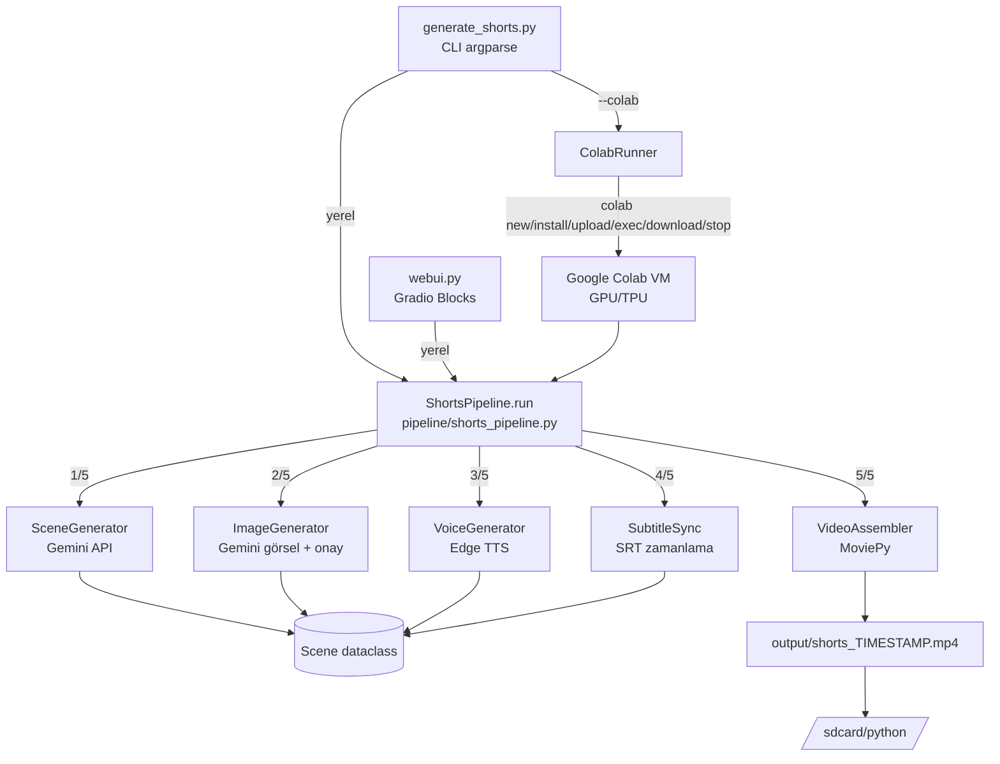

# plan.md — appShorts Beyni (Teknik Plan ve Şema)

> **Bu dosya projenin beynidir.** Her görevden önce okunur; mimari, teknik detaylar ve şemalar için tek doğruluk kaynağıdır. Kodda yapısal değişiklik olursa bu dosya aynı gün güncellenir. Davranış kuralları: [.clinerules](.clinerules).
>
> **Ekler:** [colab.md](colab.md) — Google Colab CLI uzaktan çalıştırma detayları.

## 1. Genel Bakış

YouTube Shorts formatında (dikey 9:16, 1080x1920, 40-60 sn) videolar otomatik üreten Python pipeline'ı. Kullanıcı bir konu verir; sistem AI senaryo üretir, stok video indirir, Türkçe seslendirir, altyazı senkronlar ve MP4 montajlar.

| Özellik | Değer |
|---|---|
| Dil / Sürüm | Python 3.13.15 (Colab runtime hizası; uv ile yönetilen `.venv`) |
| Paket yöneticisi | `uv` (`uv pip install -r requirements.txt`) |
| AI Model | Gemini `gemini-3.5-flash-lite` (`google-genai`) veya anahtarsız Workers AI (`@cf/meta/llama-3.2-3b-instruct`, `cf` CLI OAuth) |
| Sahne Görselleri | Workers AI Flux 1 Schnell (`cf` CLI OAuth) veya Gemini görsel modeli (`GEMINI_IMAGE_MODEL`, default `gemini-2.5-flash-image`) + onay/değiştir akışı |
| Seslendirme | Edge TTS `tr-TR-AhmetNeural` |
| Montaj | MoviePy **2.x** + FFmpeg |
| Çıktı | 1080x1920 MP4, 40-60 sn |
| Test | `unittest` + `unittest.mock`, `pytest` ile (164 test, 11 dosya) |
| CLI | `argparse` — `generate_shorts.py` |
| Web UI | Gradio 6 — `webui.py` (`0.0.0.0` bind + `*.gradio.live` public link) |

## 2. Mimari Şema



Katmanlar: **CLI** → **Pipeline (orkestrasyon)** → **Services (iş mantığı)** → **config.py (ayarlar)**. Servisler birbirini çağırmaz; veri yalnızca `Scene` üzerinden akar.

## 3. Dosya Yapısı

```
/root/appShorts/
├── plan.md                 # BEYİN — bu dosya
├── colab.md                # EK — Colab CLI uzaktan çalıştırma
├── .clinerules             # Cline davranış kuralları (token tasarrufu, plan.md kuralı)
├── .clineignore            # Bağlam dışı: .env, .venv/, output/, medya, cache
├── .env / .env.example     # GEMINI_API_KEY, PEXELS_API_KEY, COLAB_* (asla okunmaz)
├── .python-version         # uv için 3.13.15 (Colab runtime hizası)
├── config.py               # Merkezi ayarlar + dizin oluşturucu
├── generate_shorts.py      # CLI giriş noktası
├── webui.py                # Gradio web arayüzü (dış erişim: 0.0.0.0 + public link)
├── generate_shorts.ipynb   # Tek dosya Colab defteri: %%writefile ile tüm proje + gömülü anahtarlar
├── requirements.txt        # google-genai, edge-tts, moviepy, gradio, python-dotenv, requests, decorator
├── services/
│   ├── scene_generator.py  # Scene dataclass + SceneGenerator (Cloudflare CLI/Gemini, JSON parse, retry, validate)
│   ├── cloudflare_cli.py   # CloudflareCLI (cf OAuth profil, Workers AI alt süreç/binary REST çağrısı)
│   ├── cloudflare_model_catalog.py # Canlı model kataloğu, Free filtreleme, aile payload/yanıt adaptörleri
│   ├── image_generator.py  # ImageGenerator (Cloudflare CLI/REST/Gemini görsel + onay akışı)
│   ├── voice_generator.py  # VoiceGenerator (edge/ttsai, kelime zamanlaması, süre hesabı)
│   ├── cloudflare_tts.py   # CloudflareTTS (Workers AI CLI/REST, base64 ses decode)
│   ├── audio_factory.py    # get_voice_generator() — TTS motoru fabrikası (edge/cloudflare/ttsai)
│   ├── subtitle_sync.py    # SubtitleSync (SRT üretimi, satır bölme, format_time)
│   ├── video_assembler.py  # VideoAssembler (resize, altyazı overlay, montaj)
│   └── colab_runner.py     # ColabRunner (bundle upload, 5 adım, one-shot)
├── pipeline/
│   └── shorts_pipeline.py  # ShortsPipeline.run / run_with_progress
├── tests/                  # 9 unittest dosyası (147 test)
├── output/                 # Üretim çıktıları (ignore): shorts_TIMESTAMP.mp4
├── .tmp/                   # Tüm geçiciler (ignore): images/, audio/, video/ (moviepy temp), subtitles.srt
└── .venv/                  # Tek geçerli ortam (uv, py3.13.15 — Colab hizalı) — venv/ silinmiştir
```

## 4. Veri Şeması — `Scene`

```python
@dataclass                      # services/scene_generator.py
class Scene:
    id: int
    text: str                   # Türkçe sahne metni (seslendirme + altyazı)
    visual_description: str     # İngilizce görsel açıklama
    search_query: str           # Gemini görsel üretim ipuçları (İngilizce)
    duration: float             # saniye, 6-12 arası; toplam 40-60
    image_path: str = ""        # adım 2'de onaylanan görsel
    image_candidates: List[str] # adım 2'de üretilen adaylar
    audio_path: str = ""        # adım 3'te dolar
```

Gemini çıktısı: `{"scenes": [{id, text, visual_description, search_query, duration}]}` — `{{...}}` escape'li prompt şablonu (`PROMPT_TEMPLATE`) ile üretilir, `_extract_json()` ile ayrıştırılır.

## 5. Pipeline Akışı (5 Adım)

| # | Adım | Servis | Girdi → Çıktı |
|---|------|--------|----------------|
| 1 | Sahne üretimi | `SceneGenerator.generate_scenes(topic)` (retry 3, `validate_scenes`) | topic → `List[Scene]` |
| 2 | Sahne görselleri | `ImageGenerator.generate_all_images(scenes, interactive)` (aday üretimi + onay: Enter/d/s/q) | `visual_description` → `.tmp/images/scene_XX_*.png` (kota/üretim yoksa siyah zemin) |
| 3 | Seslendirme | `VoiceGenerator.generate_all_voiceovers(scenes)` | `text` → `.tmp/audio/*.mp3` (+ `.words.json` kelime zamanlaması) |
| 4 | Altyazı | `SubtitleSync.generate_srt(scenes)` | **kelime sınırları** → `.tmp/subtitles.srt` |
| 5 | Montaj | `VideoAssembler.assemble_video(scenes)` | hepsi → `output/shorts_TIMESTAMP.mp4` |

Süre kontrolü: toplam 40-60 sn (`MIN_DURATION`/`MAX_DURATION`); kısa sahne döngüye, uzunsa kırpılmaya tabidir.

## 6. Yapılandırma Özeti (`config.py`)

- **Yollar**: `BASE_DIR`, `OUTPUT_DIR` (biten videolar), `TMP_DIR` = `BASE_DIR/.tmp` (**tüm geçiciler**), `IMAGES_DIR`, `AUDIO_DIR`, `VIDEO_TMP_DIR` (moviepy render temp) — import'ta otomatik oluşur
- **Video**: 1080x1920, 40-60 sn, 5-8 sahne
- **Görseller**: `IMAGE_PROVIDER=cloudflare` (default) → **Cloudflare Workers AI** (`@cf/black-forest-labs/flux-1-schnell`, OAuth CLI veya REST; görsel girdisi `steps`, `CLOUDFLARE_IMAGE_STEPS=4`; **boş/solid resim algılama**: 32x32 grayscale std < 3 reddedilir, 1 kez taze seed ile yeniden denenir) → **401/403'te zincir kesilmez**: token reddedilirse net uyarı basılır, tekrar deneme yapılmaz ve **Pollinations.ai** (anahtarsız) → **Gemini** (`IMAGE_FALLBACK_GEMINI`) → son çare prosedürel gradient. **Sahne başına 1 resim** (`IMAGE_CANDIDATES=1`), **onay yok** (`APPROVE_IMAGES=false`; `APPROVE_IMAGES=true` + TTY ile eski Enter/d/s/q akışı geri gelir). `IMAGE_PROVIDER=gemini` ile eski zincir: Gemini failover (`GEMINI_IMAGE_MODEL`, `IMAGE_MAX_RETRIES=3`) → kota dolunca Cloudflare → Pollinations → gradient (env `IMAGE_PROVIDER`/`IMAGE_CANDIDATES`/`APPROVE_IMAGES`/`IMAGE_FALLBACK_POLLINATIONS`/`IMAGE_FALLBACK_GEMINI`)
- **Ses**: `tr-TR` / `tr-TR-AhmetNeural` — **403/throttle backoff**: deneme arası üstel bekleme (`TTS_MAX_RETRIES=5`, `TTS_RETRY_BASE_DELAY=3.0` sn → 3/6/12/24 sn) + sahneler arası `TTS_SCENE_DELAY=1.5` sn. Edge TTS bağlantı sonucu boş ses döndürürse (`NoAudioReceived`) kalitesiz yedeğe geçilmez. Herhangi bir sahnede ses üretilemezse pipeline **sessiz video üretmez**, `RuntimeError` ile durur
- **Altyazı**: **TikTok akordiyon karaoke** (default `SUBTITLE_STYLE=karaoke`): zamanlama **Edge TTS WordBoundary** ile gerçek kelime sınırlarından (`boundary="WordBoundary"`, `Scene.word_timings`, `<audio>.words.json` sidecar; sınır yoksa uzunluk-oransal fallback). Kelimeler **disjoint gruplara** ayrılır (`SUBTITLE_WORDS_PER_GROUP=3`, kayan pencere YOK → tekrar yok). Kutu: `pad 34px`, min yükseklik `font_size*2` (metin sığmaz sorunu çözüldü), dikey ortalı. **Opak siyah kutu** (alpha 255, TikTok standardi) + **sarı** metin (`SUBTITLE_COLOR=yellow`) + **aktif kelime beyaz** vurgu (`SUBTITLE_EMPHASIS_COLOR=white`), 14px ease-out pop. `SUBTITLE_STYLE=caption` ile klasik satır altyazı. NotoSans-Bold bundle (`assets/fonts/`), 52pt, siyah stroke 4, alt-orta, `SUBTITLE_Y_OFFSET=150`. **SRT senkronizasyonu**: `SubtitleSync.calculate_subtitle_timing()` satır sınırlarını gerçek kelime zamanlarından alır (ilk/son kelime = satır başı/bitiş) ve sahne ofsetlerini assembler'ın **crossfade zaman çizelgesiyle** birebir aynı formülle hesaplar (`sum(duration)-i*SCENE_TRANSITION`) → altyazı video ile kare kare uyumlu (kelime sınırı yoksa karakter-oranlı fallback)
- **Geçiş**: sahneler arası **crossfade** (`SCENE_TRANSITION=0.4` sn; `concatenate(padding=-0.4)` + `CrossFadeIn/Out`) + Ken Burns zoom (%6)
- **API**: `GEMINI_API_KEY` (`.env`, `load_dotenv`) — Pexels kaldırıldı
- **TTS bağımlılığı**: `edge-tts>=6.1.0`; düşük kaliteli/anahtarsız robot fallback kaldırıldı
- **Colab**: `COLAB_ENABLED/GPU/TPU/SESSION_NAME/HIGH_MEM`
- **Cloudflare Workers AI kimlik doğrulama**: Varsayılan **anahtarsız `cf` CLI OAuth profilidir**. `npm install --global cf`; `.venv/bin/python generate_shorts.py --cf-login` → `cf auth login --device --no-browser` ile kullanıcı onayı. `services/cloudflare_cli.py` alt sürece `CLOUDFLARE_API_TOKEN`/`CLOUDFLARE_API_KEY` aktarmaz (geçersiz ortam token'ı OAuth profilini gölgelemesin); `cf ai run MODEL --body JSON` çağrılır. Aktif modeller: senaryo `@cf/meta/llama-3.2-3b-instruct`, görsel `@cf/black-forest-labs/flux-1-schnell` (`steps=4`), TTS `@cf/myshell-ai/melotts` (WAV; `en/es/fr/jp/kr/zh`, Türkçe yok). Eski `.env` model adları servis düzeyinde aktif modellere eşlenir. `CLOUDFLARE_CLI_COMMAND/PROFILE/TIMEOUT` + `CLOUDFLARE_TEXT_MODEL` config ayarlarıdır. REST `CLOUDFLARE_ACCOUNT_ID` + `CLOUDFLARE_API_TOKEN` yolu geriye dönük alternatiftir
- **Auth önceliği (2026-10-23)**: API anahtarı istemeyen `cf` OAuth oturumu tercih edilir (`--cf-login`). Mevcut `CLOUDFLARE_API_TOKEN` geçersiz olduğu için REST yolu 401 verir; REST zorunlu kalırsa Dashboard → My Profile → API Tokens → Edit/Create ve gerekli izinler: *Account → Workers AI → Edit* + *Account → Account Settings → Read* + *Account → Workers Scripts → Edit*
- **Anahtar sağlık durumu (2026-10-23 canlı ölçüm)**: `GEMINI_API_KEY` **geçerli** (models endpointi HTTP 200), `CLOUDFLARE_ACCOUNT_ID` format olarak doğru (32 hex), **`CLOUDFLARE_API_TOKEN` geçersiz** (`/user/tokens/verify` → HTTP 401 "Invalid API Token"; CLI `cf auth whoami` → `tokenValid: false`, `wrangler whoami` → 9109) → Workers AI 401 → görseller gradient'e düşüyordu, artık Pollinations/Gemini fallback'i devreye giriyor. `TTS_AI_API_KEY` ve `PEXELS_API_KEY` tanımlı değil (bu akışta gerekmiyor). Token yenileme: Cloudflare Dashboard → My Profile → API Tokens → **Edit** (veya Create Token) → gerekli izinler: *Account → Workers AI → Edit* + *Account → Account Settings → Read* + *Account → Workers Scripts → Edit* → yeni token'ı `.env` içindeki `CLOUDFLARE_API_TOKEN` değerine yaz (`.env` asla okunmaz/raporlanmaz, yalnızca `config.py` üzerinden erişilir)
- **Web UI**: Gradio 6 (`webui.py`) — `GRADIO_HOST` (default `0.0.0.0` = dışarıdan erişilebilir), `GRADIO_PORT` (7860; **tercih edilen port**, doluysa 100 portluk aralıkta sonraki boş port seçilir; `--port` açıkça verilirse dolu port değiştirilmez ve net hata verilir), `GRADIO_SHARE` (true → `*.gradio.live` public link), `GRADIO_AUTH_USER`/`GRADIO_AUTH_PASS` (basit parola koruması — public link için önerilir), `GRADIO_MAX_QUEUE` (4), `GRADIO_TITLE`. Arayüz: konu + TTS seçimi + **üç Workers AI tekil model dropdown'ı**, **canlı log** (5 adım), video önizleme, sahne görseli galerisi, **önceki videolar arşivi** (`output/*.mp4` → tarih/boyut etiketli dropdown + arşiv önizleme oynatıcı; üretim sonrası ve sayfa açılışında otomatik yenilenir). Pipeline stdout'u arka plan thread'inde yakalanıp kuyrukla canlı akıtılır; **tek üretim kilidi** (paralel koşu yok — ortak `.tmp` çakışmasın).
- **Workers AI model seçimi (2026-10-24)**: `services/cloudflare_model_catalog.py` canlı `cf ai models list --per-page 100` kataloğunu okur; `require_workers_paid` taşıyan modelleri eleyerek güncel **31 Text Generation / 10 Text-to-Image / 4 Text-to-Speech** modelini üç tekil dropdown'a yazar. Seçimler `ShortsPipeline(text_model,image_model,tts_model)` üzerinden servislere açıkça taşınır; global `config` model değerleri değiştirilmez. Metin adaptörü `messages`/`input`/`prompt` şemalarını ve `response`/`choices` yanıtlarını, TTS adaptörü MeloTTS (`prompt/lang`) ile Aura (`text/encoding/container/speaker`) gövdelerini, görsel adaptörü Flux 2 `multipart` ile JSON `steps/num_steps` gövdelerini destekler. Erişim onayı gerektiren iki model ve LoRA modelleri dropdown etiketinde işaretlenir; özel amaçlı `clef/clairic/llama-guard` modelleri video senaryosu üretemediği için açık hata verir. Aura'nın binary yanıtı `cf ai run` yerine OAuth profil tokenıyla REST'ten korunur; token hiçbir loga yazılmaz.

## 7. Komutlar
# Anahtarsız Cloudflare OAuth girişi
.venv/bin/python generate_shorts.py --cf-login
# Üretim (yerel)

```bash
# Üretim (yerel)
.venv/bin/python generate_shorts.py "Yapay zeka nedir?"
# Uzak (detay: colab.md)
.venv/bin/python generate_shorts.py "Konu" --colab --gpu T4
# Test
.venv/bin/python -m pytest tests/ -v
# Web arayüzü (dışarıdan erişilebilir)
.venv/bin/python webui.py                     # 0.0.0.0:7860 + *.gradio.live public link
.venv/bin/python webui.py --no-share          # sadece yerel/ağ erişimi
.venv/bin/python webui.py --host 0.0.0.0 --port 8080
# Bağımlılık
uv pip install -r requirements.txt
```

## 8. Test Stratejisi

- `tests/test_config.py`, `test_pipeline.py`, `test_scene_generator.py`, `test_image_generator.py`, `test_subtitle_sync.py`, `test_video_assembler.py`, `test_voice_generator.py`, `test_colab_runner.py`, `test_webui.py`
- Hepsi `unittest.TestCase`; dış API'ler `unittest.mock.patch/MagicMock` ile izole (gerçek API çağrılmaz)
- Doğrulama: `.venv/bin/python -m pytest tests/ -v` — değişiklikten sonra ZORUNLU

## 9. Dokümantasyon Haritası

| Dosya | Rol |
|---|---|
| **plan.md** | Beyin — teknik detay + şema, her görevden önce okunur |
| **colab.md** | Ek — Colab CLI komutları, ColabRunner akışı, notebook akışı |
| **.clinerules** | Davranış — token tasarrufu, ortam/güvenlik/test kuralları |
| **README.md** | Kullanıcıya yönelik tanıtım ve kurulum |

## 10. Değişlik Günlüğü

| Tarih | Değişiklik |
|---|---|
| 2026-10-07 | `plan.md` (beyin) oluşturuldu; `colab.md` eklendi; `.clinerules`/`.clineignore` oluşturuldu; kullanılmayan `venv/` silindi |
| 2026-10-07 | `services/colab_runner.py` onarıldı: `colab exec --timeout 1800`, `install -r` yerel yol, `.env` bundle'a eklendi, `OUTPUT_PATH` yakalama, `shorts_*` arama önceliği, güvenli `stop/finally`; global `colab` CLI sıfırdan kuruldu; `tests/test_colab_runner.py` (+8 test) |
| 2026-10-07 | `generate_shorts.ipynb` yeniden yazıldı: self-contained (9 `%%writefile` + gömülü API anahtarları + `generate(topic)` API); Colab CLI yolu ikincil ilan edildi |
| 2026-10-07 | Colab hata düzeltmeleri: (1) `VoiceGenerator._run_coro` — çalışan event loop içinde (ipykernel) TTS için thread offload, `asyncio.run` RuntimeWarning çözüldü; (2) `config._resolve_subtitle_font` — sistem/matplotlib font adayları taraması + `SUBTITLE_FONT` env override (Colab font hatası çözüldü); notebook pip hücresine `fonts-dejavu-core` ikinci güvencesi; testler 57→61 |
| 2026-10-07 | Not defteri pip hücresi düzeltildi: `moviepy>=2.0.0` pini + kurulum doğrulama (Colab'de 1.0.3 'already satisfied' tuzağı) |
| 2026-10-08 | Colab runtime hizası: `.venv` sıfırdan `uv` ile CPython **3.13.15**'e kuruldu (`uv python install 3.13.15` + `.python-version`); not defteri pip hücresine `jedi` eklendi — Colab taban ortamında `ipython 7.34.0 requires jedi>=0.16` eksikliğinden kaynaklanan sahte pip 'dependency conflicts' ERROR'ı çözüldü |
| 2026-10-08 | colab-mcp ve Junie izleri temizlendi: `plan.md`'deki `colab-mcp.md`/`.junie/` referansları kaldırıldı, `.clineignore`'dan `.junie/` girişi silindi, `.junie/` dizini tamamen kaldırıldı |
| 2026-10-08 | **colab-mcp bırakıldı** (kullanılmayacak): Cline MCP ayarından `colab-mcp` sunucusu kaldırıldı, deneme artıkları (`/tmp`) temizlendi; genel bakış tablosu eski 3.12.14 yerine Colab hizası **3.13.15** olarak düzeltildi (`.python-version` + `.venv` zaten 3.13.15 idi) |
| 2026-10-08 | **Pexels bırakıldı — görsel üretimine geçildi**: `services/video_fetcher.py` silindi, `services/image_generator.py` eklendi (Gemini ile sahne başına N aday görsel + terminal onay akışı: Enter=onayla, d=değiştir, s=atla, q=iptal; TTY'siz otomatik). `Scene.video_path` → `image_path`/`image_candidates`. `config.py`: `PEXELS_*` kaldırıldı, `IMAGES_DIR`/`GEMINI_IMAGE_MODEL`/`IMAGE_CANDIDATES`/`APPROVE_IMAGES` eklendi. CLI'ye `--no-approve`. **Altyazı düzeltmesi**: `ImageClip(color=...)` (MoviePy 2.x'te geçersiz) → RGBA `ImageClip` + mask — videoda altyazı görünmeme hatası çözüldü. Assembler: `VideoFileClip` yerine görsel zemin (cover-crop + %6 Ken Burns zoom). `test_pipeline` moviepy `sys.modules` zehirlemesi kaldırıldı; testler 61→75 (`test_image_generator.py`, `test_video_assembler.py` eklendi, 2 test fontsuz makinede skip). Notebook hücreleri senkronlandı |
| 2026-10-09 | **Font kök nedeni + kota fallback**: lokal `Invalid font ... cannot open resource` hatasının sebebi fontsuz makinede resolver'ın kör fallback'iydi → `assets/fonts/NotoSans-Bold.ttf` bundle (Türkçe glifler doğrulandı) + resolver zinciri (env→sistem→matplotlib→bundle→"" asla sahte yol yok) + `get_subtitle_font()` (ilk kullanımda 1 kez indirme) + assembler'da `font=None` retry (altyazı artık hiçbir koşulda kaybolmaz). **Gemini kotasına çözüm**: model failover listesi (`GEMINI_IMAGE_MODEL="m1,m2"`) → Pollinations.ai (doğrulandı: keyless 200 OK, `width/height/seed/nologo`) → prosedürel degrade gradient (offline, konuya göre renk) — siyah zemin tarihe karıştı (açık kullanıcı `[s]` hariç). Testler 76→87, notebook senkron |
| 2026-10-08 | Canlı doğrulamada 2 ek altyazı hatası daha çözüldü: (1) altyazının tamamen ekran dışından başlaması moviepy 2.x `compose_mask`'ı patlatıyordu (`operands could not be broadcast`) → başlangıç `VIDEO_HEIGHT-10`'a çekildi (kenarda 10px görünür); (2) yarı saydam siyah altyazı zemini metinden sonra eklenerek beyaz metni %50 karartıyordu (maks 127) → zemin klipi metnin ALTINA alındı (maks 255). `assemble_video`'daki çift klip üretimi tekilleştirildi. Canlı E2E: 50sn video, 47/50 örnek frame'de tam beyaz altyazı, sıfır uyarı. Regresyon testi eklendi (font varsa 76. test); fontsuz makinede 75 |
| 2026-10-09 | **Bing kedi görseli kurtarıldı + Cloudflare Workers AI fallback**: `sl.bing.net` paylaşım linki HTML sayfasıydı (JS + guest limit, çekilemez) → kullanıcıdan alınan `th.bing.net/th/id/OIG2...` direkt resim linki public çıktı (cookie'siz `200 image/jpeg, 479KB`) → `output/tmp/images/bing_cat_garden.jpg` olarak indirildi (Pillow doğruladı: JPEG 1024x1024 RGB). **Kota zinciri genişletildi**: Gemini → **Cloudflare Workers AI** (`IMAGE_FALLBACK_CLOUDFLARE`, `CLOUDFLARE_ACCOUNT_ID/TOKEN/MODEL=stable-diffusion-xl-lightning`, `CLOUDFLARE_TIMEOUT=90`; düz REST, wrangler gerekmez — makinede wrangler yok, node v24 var; token yoksa adım atlanır; yanıt binary PNG veya JSON-base64) → Pollinations.ai → gradient. Testler 93 (Cloudflare +5, config +1); `plan.md`/`README.md`/`.env.example` senkron |
| 2026-10-09 | **Cloudflare canlı doğrulandı (OLUMSUZ→OLUMLU)**: resmi olmayan Bing yolu kapatıldı (`/tmp/bing_trial.py` silindi, kodda 0 iz, `curl_cffi` kurulmadı). Kullanıcı token'ıyla tek sahnelik canlı test: `POST .../ai/run/@cf/bytedance/stable-diffusion-xl-lightning` → **HTTP 200 `image/png`, 113KB** → `_generate_cloudflare` yoluyla `output/tmp/images/cf_trial_cat_garden.jpg` kaydedildi (Pillow: JPEG 1024x1024 RGB). Token `.env`/koda/log'a yazılmadı (sadece komut env'i, maskeli log), `/tmp` artığı silindi, sızıntı taraması temiz. Testler 93/93 |
| 2026-10-09 | **Görseller Cloudflare-only + boş resim kontrolü**: `IMAGE_PROVIDER=cloudflare` (default) — `generate_candidates` Cloudflare-only modda Gemini/Pollinations'a hiç dokunmaz; `IMAGE_PROVIDER=gemini` ile eski zincir korundu (opt-in). `ImageGenerator.__init__` cloudflare modda `GEMINI_API_KEY` zorunlu değil (lazy client). **Boş resim tespiti**: `_is_blank_image` — PIL decode + 32x32 grayscale `pstdev < 3.0` → solid/boş/kirli veri reddet; `_accept_image` tüm provider'ları (Gemini/Pollinations) sarar; Cloudflare yolunda boş yanıt → taze seed ile 1 yeniden deneme (5KB kontrolü blank-check'ten sonra). Token yoksa ağ çağrısı hiç yapılmaz → gradient. Testler 93→**103** (`TestCloudflareOnly`, `TestBlankImageDetection`, config `IMAGE_PROVIDER`); `plan.md`/`README.md`/`.env.example` senkron |
| 2026-10-09 | **Sahne başına 1 resim + onay kapalı**: `IMAGE_CANDIDATES` default `3→1`, `APPROVE_IMAGES` default `true→false` — pipeline TTY'de bile onay sormaz, üretilen ilk (ve tek) görsel doğrudan `image_path`'e gider. `test_config` bu default'ları kilitledi (1 / False). Geri isteyen `.env`'de `APPROVE_IMAGES=true` + `IMAGE_CANDIDATES=N`. `README` (Adım 2 metni) + `plan.md` §6 senkron; testler 103/103 |
| 2026-10-09 | **Sahne-ses senkronu + crossfade + TikTok karaoke altyazı**: (1) **Kök neden**: `scene.duration` LLM tahminiydi, Edge TTS sesi daha uzun geliyordu → assembler sesi `scene.duration`'a kırpıyor, sahne geçişi speech'i kesiyordu → `VoiceGenerator.generate_all_voiceovers` artık `scene.duration = gerçek ses + SCENE_AUDIO_PADDING(0.4sn)` (canlı: tahmin 6.0 → senkron 5.03/5.51sn). (2) **Efekt**: sahneler arası crossfade (`SCENE_TRANSITION=0.4`, `CrossFadeIn/Out` + `concatenate(padding=-trans)`; padding = sessiz kuyruğa biner, ses kesilmez; `CrossFade*` alt modülden import — top-level'da yok). (3) **Altyazı**: `SUBTITLE_STYLE=karaoke` (default) — akordiyon: son 3 kelime (`SUBTITLE_WORDS_PER_GROUP`) opak siyah kutuda sarı, **aktif kelime beyaz vurgulu** (tek-canvas PIL render — offset kaymasi cozuldu), kelime süreleri uzunluğa oransal, 14px ease-out pop; `caption` ile eski stil. Renk doğrulandı: frame'de sarı/beyaz/siyah pikseller. Testler 104→**108** (`TestKaraokeSubtitles` +3, `TestSceneAudioSync`, config karaoke+transition) |
| 2026-10-09 | **Altyazı 3 düzeltme (kutu/tekrar/uyum)**: (1) **Kutu taşması**: `pad_y 14→34`, min `font_size*2`, metin dikey ortalı — taşma bitti (canlı: kutu 117px). (2) **Kelime tekrarı**: kayan pencere (`max(0,i-2)`) yerine **disjoint gruplar** (`[0-2][3-5]...`) — kelime asla 2 grupta görünmez (canlı: 8 kelime/3 grup, 0 tekrar). (3) **Ses-altyazı uyumu**: edge-tts 7.2.8'de `boundary="WordBoundary"` (default `SentenceBoundary` imiş) ile gerçek kelime sınırları stream'den yakalanıp `<audio>.words.json`'a yazılır, `Scene.word_timings` yüklenir, karaoke bunları kullanır (canlı: `Zarif 0.100→0.737`, `bir 0.750→0.925`...). Boundary yoksa oransal fallback korunur. Testler 108→**111** |
| 2026-10-10 | **Edge TTS 403/throttle backoff**: hızlı art arda WSS bağlantıları aralıklı 403 veriyordu (log: sahne 6'da 2x403 sonra başarı) — önceki retry beklemesizdi. `generate_voiceover`: 5 deneme + üstel bekleme (3/6/12/24sn), `generate_all_voiceovers`: sahneler arası 1.5sn gecikme. Knob'lar `config.py`'de (`TTS_MAX_RETRIES/RETRY_BASE_DELAY/SCENE_DELAY`, `.env` override'lı). Testler 111→**112** (`test_generate_voiceover_retries_with_backoff`); `plan.md`/`README.md` senkron |
| 2026-10-11 | **Karaoke tek-canvas render**: cift TextClip overlay + prefix offset kaldirildi — kutu, sari metin ve beyaz vurgu ayni PIL RGBA canvas’a ciziliyor (olc+draw ayni font => sifir kayma); kutu opaklıgı 235→255 (TikTok). Testler 112/112 |
| 2026-10-11 | **Colab `GEMINI_IMAGE_MODEL` AttributeError düzeltildi**: defterdeki gömülü `config.py` bayattı → 9 `%%writefile` hücresi repo ile senkron edildi; `image_generator` + `voice_generator` yeni ayarlara `getattr` fallback ile erişiyor. Testler 112/112 |
| 2026-10-11 | **Colab Cloudflare kimlikleri gömüldü**: `.env`'deki `CLOUDFLARE_ACCOUNT_ID` (32ch) + `CLOUDFLARE_API_TOKEN` (53ch) defterin 2. hücresine aktarıldı (değerler cevaba/loga yazılmadı, sadece maskeli uzunluk doğrulandı). Öncelik: **Colab Secrets (`userdata`) > gömülü değer**. `BURAYA_` placeholder kalmadı; diğer 9 `%%writefile` hücresi hâlâ repo-identical; testler 112/112 |
| 2026-10-11 | **Altyazı titremesi (jitter) düzeltildi**: (1) Karaoke kelime adımlarındaki 14px "pop"/rise animasyonu her kelime değişiminde tüm kutuyu zıplatıyor → `VideoAssembler._create_karaoke_word_clip` animasyon kaldırıldı, kutu sabit pozisyona alındı; sadece beyaz vurgu kelime arasında değişiyor. (2) Y pozisyonu artık `int` → her karede sub-piksel resampling ile shimmer yok (test: başlangıç/end pozisyonları eşit, kareler pixel-bir-birine). (3) Klasik caption yolu da sabitlendi: kayan (scroll-up) animasyon yerine sabit alt konum — hareket eden kutu her çerçevede titriyordu. Testler 112→**113** (`test_karaoke_position_is_static_no_jitter` +1); diğer 9 `%%writefile` hücreleri Colab defterine senkron edildi. |
| 2026-10-11 | **"5 denemede ses üretemedi" gizli kaldı** — `VoiceGenerator.generate_voiceover`: 5 başarısız deneme sonunda sadece `Warning: Could not generate voiceover` yazıyordu, asıl hata (`edge_tts` WSS hatası, 403 vb.) kayboluyordu. İlk başarısız denemedeki exception saklanıyor ve tüm denemeler bittiğinde `✗ Could not generate voiceover for scene N after 5 attempts: <gerçek hata>` + çözüm ipuçları yazılıyor. Test: mock exception ile gerçek hatanın gösterildiği doğrulandı; testler 113/113. |
| 2026-10-11 | **Başlangıçta TTS motoru seçimi + Cloudflare Workers AI TTS**: (1) `config.TTS_PROVIDER` eklendi (`edge` varsayılan | `cloudflare`); CLI `--tts edge|cloudflare`, Colab `generate(topic, voice_service=...)`. TTY başlangıçta interaktif seçim: `[1] edge-tts (ücretsiz, hızlı) · [2] cloudflare (Workers AI Llama TTS, ACCOUNT_ID+TOKEN gerekir) · [3] atla (edge)` → seçim `config.TTS_PROVIDER`'a kaydedilir. (2) Yeni servis `services/cloudflare_tts.py`: düz REST Workers AI (`@cf/meta/llama-3.2-1b-ptt-text-to-speech`, base64 audio decode), quota 429'da model failover. (3) `services/audio_factory.py` fabrika: `get_voice_generator()` edge/Cloudflare ayrımını pipeline'dan soyutlar. Fabrika seçimi interaktif test edildi (cloudflare→CloudflareTTS, edge→VoiceGenerator, config override); CLI + Colab `generate()` senkron; testler 113/113 (değişiklikler geriye uyumlu). |

| 2026-10-12 | **Ücretsiz TTS seçenekleri genişletildi**: `VoiceGenerator` artık 4 motoru yönetir — `edge` (varsayılan, kelime zamanlaması), `cloudflare` (Workers AI, şu an erişilemiyor → edge'e düşer), `ttsai` (daha kaliteli ses, ücretsiz 15k karakter/gün, TTS_AI_API_KEY gerekir), `gtts` (Google Translate TTS, tamamen keysiz, Türkçe destekli, robot ses). `config.TTS_PROVIDER` bu değerleri alır; CLI menüsü `[1] edge · [2] cloudflare · [3] ttsai · [4] gtts · [5] atla` oldu; Colab `generate()` + `_choose_tts_engine` menüsü senkron edildi. TTS.ai API'si artık keysiz çalışmıyor (401); GTTS test edildi: 55KB ses, ~7sn. `config.py` → `TTS_AI_API_KEY`, `TTS_AI_MODEL`; `.env.example` ve notebook menüsü güncellendi. Testler 113/113.
| 2026-10-23 | **Gradio web arayüzü + dış erişim**: yeni `webui.py` (`gr.Blocks`) — konu metni + TTS motoru seçimi, **canlı log** (pipeline stdout'u arka plan thread'inde yakalanıp kuyrukla akıtılır), video önizleme (`gr.Video`), sahne görseli galerisi. Dış erişim: `GRADIO_HOST=0.0.0.0` (varsayılan) + `GRADIO_SHARE=true` → `*.gradio.live` public link (parola koruması `GRADIO_AUTH_USER/PASS` ile); erişilen link `output/webui_url.txt`'ye yazılır. `config.py` → `GRADIO_*` ayarları, `requirements.txt` → `gradio>=6.0.0`, `.env.example` → `GRADIO_*` şablonu. Tek üretim kilidi (paralel koşu yok). Gradio 6 API uyumu: `theme` → `launch()`'a taşındı, `Textbox.show_copy_button` kaldırıldı. Testler 113→**129** (`tests/test_webui.py`, +16; mock'lu launch testleri artık gerçek `output/` dizinine yazmıyor). `plan.md` bayat sayaçları (75/57 test, eksik servis dosyaları, var olmayan `test_video_fetcher.py`) gerçek durumla senkronlandı. |
| 2026-10-23 | **Cloudflare CLI OAuth ile anahtarsız kullanım**: `services/cloudflare_cli.py` eklendi; `cf auth login --device --no-browser` profili Workers AI için senaryo metni (`CLOUDFLARE_TEXT_MODEL`), görsel (`CLOUDFLARE_IMAGE_MODEL`) ve TTS (`CLOUDFLARE_TTS_MODEL`) çağrılarında kullanılır. Alt sürece `CLOUDFLARE_API_TOKEN`/`CLOUDFLARE_API_KEY` aktarılmaz; böylece geçersiz ortam token'ı OAuth profilini gölgelemez. `generate_shorts.py --cf-login` OAuth/device akışını başlatır; Gemini anahtarı yoksa CLI oturumu AI sağlayıcısı olarak kabul edilir. REST token yolu geriye dönük korunur. `config.py` → `CLOUDFLARE_CLI_COMMAND/PROFILE/TIMEOUT`, `CLOUDFLARE_TEXT_MODEL`; `.env.example`/`README.md`/`plan.md` senkron. Testler 147→**154** (`tests/test_cloudflare_cli.py` +6, `test_scene_generator.py` +1) |
| 2026-10-23 | **Web UI port çakışması düzeltildi**: `webui.py` artık sabit port yerine `GRADIO_PORT`u tercih edilen port olarak kullanır; port doluysa socket bind ile bir sonraki boş portu seçer. Açıkça verilen `--port` doluysa sessizce değiştirilmez, `Port ... is already in use` hatası verilir. Gerçek doğrulamada açık `7860` varken yeni örnek `7861`de başladı; doğrulama Web UI süreçleri sonrasında kapatıldı. Testler 158→**162** (`test_webui.py` +4) |
| 2026-10-23 | **Workers AI aktif modelleri canlı doğrulandı**: metin `@cf/meta/llama-3.2-3b-instruct` (JSON modu + güvenli literal sözlük onarımı), görsel `@cf/black-forest-labs/flux-1-schnell` (`steps`, `CLOUDFLARE_IMAGE_STEPS=4`), TTS `@cf/myshell-ai/melotts` (`prompt`/`lang`, base64 WAV; yalnızca `en/es/fr/jp/kr/zh`, Türkçe yok). Eski `.env` model adları servis düzeyinde aktif modellere eşlenir. Canlı OAuth: 6 benzersiz sahne (46 sn), 1024×1024 JPEG görsel ve geçerli 44.1 kHz mono WAV doğrulandı. Testler 154→**158** (`tests/test_cloudflare_tts.py` +2, JSON literal +1, Flux steps +1) |
| 2026-10-23 | **Düşük kaliteli gTTS kaldırıldı + Clipchamp incelemesi**: Web UI logunda Edge TTS'in 6 sahnenin 5'inde boş ses döndürdüğü görülmüştü. İlk düzeltmede anahtarsız `gTTS` fallback'i eklenmişti, ancak ses kalitesi kabul edilmemiştir; `gTTS` bağımlılığı, provider seçenekleri, CLI/Web UI menüleri, testleri ve yapılandırmasından tamamen kaldırıldı. Edge boş ses döndürürse artık kalitesiz yedeğe geçilmez; herhangi bir sahnede ses üretilemezse pipeline `RuntimeError` ile durur ve sessiz video üretmez. Clipchamp AI Voice Generator sayfası HTTP 200/Chromium ile doğrulandı: 400 ses, 80 dil (Türkçe dahil), pitch/emotion, 0.5x–2x hız, ücretsiz MP3-only export; Microsoft hesabı girişi gerekir. Public özellik/fiyat sayfalarında TTS API/SDK belirtilmediğinden Clipchamp `appShorts` içine doğrudan provider olarak eklenmedi |


| 2026-10-23 | **(1) Geçiciler `.tmp/`'ye taşındı**: `config.TMP_DIR` artık `BASE_DIR/.tmp` (eski: `output/tmp`); `IMAGES_DIR`/`AUDIO_DIR`/`VIDEO_TMP_DIR` (moviepy render temp) alt klasörler; biten videolar `output/`'da kalır. MoviePy 2.x `write_videofile(temp_audiofile_path=<dizin>)` ile `*TEMP_MPY*` artıkları da `.tmp/video/` altına düşüyor (kök dizine taşma bitti; 2.1.2'de `temp_videofile_path` parametresi yok). `.clineignore` → `.tmp/`. **(2) Ses–altyazı senkronu düzeltildi**: `SubtitleSync` artık (a) satır sınırlarını Edge TTS **kelime sınırlarından** alıyor (ilk kelime = satır başı, son kelime = satır bitiş; kelime–metin hizalama büyük/küçük harf ve noktalama duyarsız, eşleşmezse karakter-oranlı fallback), (b) sahne ofsetlerini assembler'ın **crossfade zaman çizelgesiyle aynı formülle** hesaplıyor (`sum(duration)-i*SCENE_TRANSITION`; eskiden `padding == crossfade` eşitliğine körü körüne bağlıydı), (c) `format_time` milisaniyeyi yuvarlıyor (2.53 → "2,530"). **Ölçüm**: render edilen MP4'e FFT korelasyonuyla her sahne sesinin gerçek konumu ölçüldü → **en büyük hata 0 ms** (eski algoritma: **745 ms**); SRT satır başı ↔ gerçek kelime başı = 0 ms. **(3) Gradio video arşivi**: `output/*.mp4` tarih/boyut etiketli dropdown'da listeleniyor, seçilen video arşiv oynatıcısında açılıyor; liste üretim sonrası + sayfa açılışında otomatik yenileniyor (Gradio 6'da seçenekler **güncelleme nesnesi** ile (`gr.update(choices=...)`) değiştirilmeli — düz liste "değer" olarak yorumlanıyor ve sunucu tarafı seçenek listesi bayat kalıp input doğrulamasını kırıyor; en yeni video otomatik açılıyor). Testler 129→**142** (`test_subtitle_sync` +5 senkron testi, `test_config` +1 `.tmp` testi, `test_webui` +7 arşiv testi). `plan.md`/`README.md` senkron. |

| 2026-10-23 | **Cloudflare CLI kuruldu + anahtar sağlık ölçümü + görsel fallback zinciri**: `npm install --global cf` → `cf` 1.0.0-beta.21 (çalışma zamanı bağımlılığı değil, teşhis aracı); ayrıca `wrangler` 4.152.0 (`--allow-scripts=workerd,esbuild` gerekli, npm 11 uyarısı). **Canlı anahtar ölçümü** (değerler hiçbir yerde okunmadı/raporlanmadı, yalnızca `config.py` üzerinden): `GEMINI_API_KEY` **geçerli** (HTTP 200), `CLOUDFLARE_ACCOUNT_ID` format doğru (32 hex), **`CLOUDFLARE_API_TOKEN` GEÇERSİZ** (`/user/tokens/verify` 401 "Invalid API Token"; `cf auth whoami` → `tokenValid:false`; `wrangler whoami` → 9109 "Invalid access token"); token 53 karakter (Cloudflare tokenları normalde 40) → iptal edilmiş/süresi dolmuş/yanlış alan. `TTS_AI_API_KEY`/`PEXELS_API_KEY` tanımlı değil (gerekmiyor). **Düzeltme (P2)**: Cloudflare yolu artık 401/403'te zinciri kesmiyor → net uyarı + tekrar deneme yok (sahne başına 5 boş istek yerine 1) + **Pollinations.ai (anahtarsız) → Gemini (`IMAGE_FALLBACK_GEMINI`) → gradient** fallback sırası; `IMAGE_FALLBACK_GEMINI` config'e eklendi, `.env.example` senkron. **Canlı doğrulama**: bozuk tokenla tek sahne → 401 mesajı → Pollinations → gerçek görsel (576×1024, 60 KB, piksel std 53.5 = gradient değil). Testler 142→**147** (`test_image_generator`: +5 fallback/401 testi, eski "Cloudflare yoksa boş dön" testi yeni sözleşmeye güncellendi). `plan.md`/`README.md` senkron. |
| 2026-10-24 | **Web UI Workers AI model seçimi**: Canlı `cf ai models list` kataloğundan Paid olmayan **31 metin + 10 görsel + 4 TTS** modeli üç tekil dropdown'a eklendi. `services/cloudflare_model_catalog.py` aile bazlı metin (`messages/input/prompt`), TTS (MeloTTS/Aura) ve görsel (JSON/multipart) payload/yanıt adaptörlerini merkezileştirir; seçimler `ShortsPipeline` → servis constructorları üzerinden taşınır, global config değişmez. Erişim onayı/LoRA işaretleri ve özel amaçlı model hataları açıktır. Aura binary REST yolu OAuth profilini kullanır (`cf ai run` binary yanıtı kaybettiği için); token loglanmaz. Canlı ölçüm: GPT-OSS 6 sahne/48 sn, Flux 1 JPEG (104.935 B), Flux 2 gerçek multipart JPEG (448.003 B), Aura-2 WAV (109.484 B) başarılı. Testler 164→**182**; `plan.md`/`README.md`/`.env.example` senkron. |
